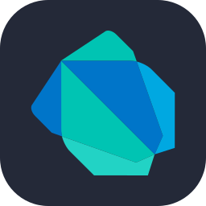
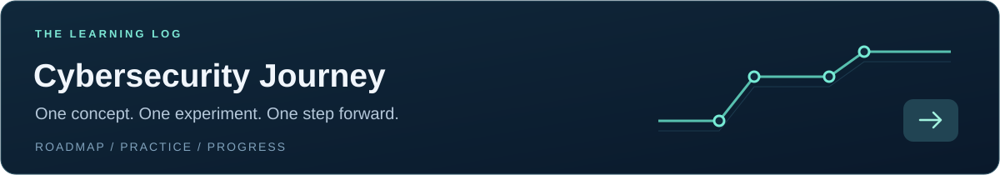

  <picture>
    <source media="(max-width: 600px)" srcset="assets/profile-banner-mobile.svg" />
    
  </picture>

   &nbsp;&nbsp;&nbsp; 
   &nbsp;&nbsp;&nbsp; 
   &nbsp;&nbsp;&nbsp; 
   &nbsp;&nbsp;&nbsp; 
  

## About

I'm **Yossof Al-Madhagi**, a cybersecurity bachelor's student from **Yemen**. I enjoy turning ideas into code and understanding how the systems behind it work.

I'm strengthening my **Python, Linux, and networking** foundations, with a long-term interest in **application, web, and cloud security**. My approach is hands-on: learn a concept, build something with it, and document what I understand.

| Learning now | Exploring next |
| :--- | :--- |
| Programming fundamentals · Linux · Networking | Secure development · Application & web security · Cloud security |

## Toolkit

Technologies I've written code with:

**Programming**

   &nbsp;
   &nbsp;
   &nbsp;
   &nbsp;
  

Python · Java · C++ · Dart · JavaScript

**Web & mobile**

   &nbsp;
   &nbsp;
  

HTML · CSS · Flutter

## Learning in public

<a href="https://github.com/YossofAlmadhagi/-Cybersecurity-Journey">
  <picture>
    <source media="(max-width: 600px)" srcset="assets/journey-mobile.svg" />
    
  </picture>
</a>

My learning roadmap and progress live in **[Cybersecurity Journey](https://github.com/YossofAlmadhagi/-Cybersecurity-Journey)**. I'll document exercises, discoveries, and lessons learned as I progress.

## GitHub activity

  

Public activity · Refreshed daily · Private work is not included

---

<strong>Let's learn and build together.</strong> 
Open to educational collaborations and conversations about software and security.  

