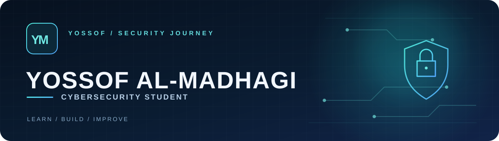

<p align="center">
  
</p>

<p align="center">
  <strong>Cybersecurity student · Building with Python, Java &amp; C++</strong><br />
  طالب أمن سيبراني أتعلم، أبني، وأوثّق ما أتعلمه في الأمن والبرمجة.
</p>

---

### 01 / About me · نبذة عني

I'm Yossof Salah. My current focus is penetration testing and network security. I use my projects to turn what I learn into working software, then improve their tests, documentation, and usability.

أنا يوسف صلاح، أركز حاليًا على اختبار الاختراق وأمن الشبكات، وأستخدم مشاريعي لتطبيق ما أتعلمه عمليًا.

```python
class YossofSalah:
    role = "Cybersecurity Student"
    focus = ("Penetration Testing", "Network Security")
    languages = ("Python", "Java", "C++")
    building = "StegoNode"
```

### 02 / Featured work · مشروع مميز

| Project | What it does | Explore |
| :--- | :--- | :--- |
| **StegoNode** | Python desktop app for concealing encrypted files in image carriers. | [Code & setup guide](https://github.com/YossofAlmadhagi/StegoNode) |

### 03 / Toolkit · الأدوات

`Python` `Java` `C++` `Linux` `Bash` `Git` `Kali Linux`

### 04 / Connect · تواصل

[Email](mailto:azannfrindsmy@gmail.com) · [Instagram](https://www.instagram.com/yossof_github?igsh=MWJ6Z2R0eTdwZmJxeA==) · [GitHub repositories](https://github.com/YossofAlmadhagi?tab=repositories)

<p align="center"><sub>LEARN / BUILD / SECURE</sub></p>

